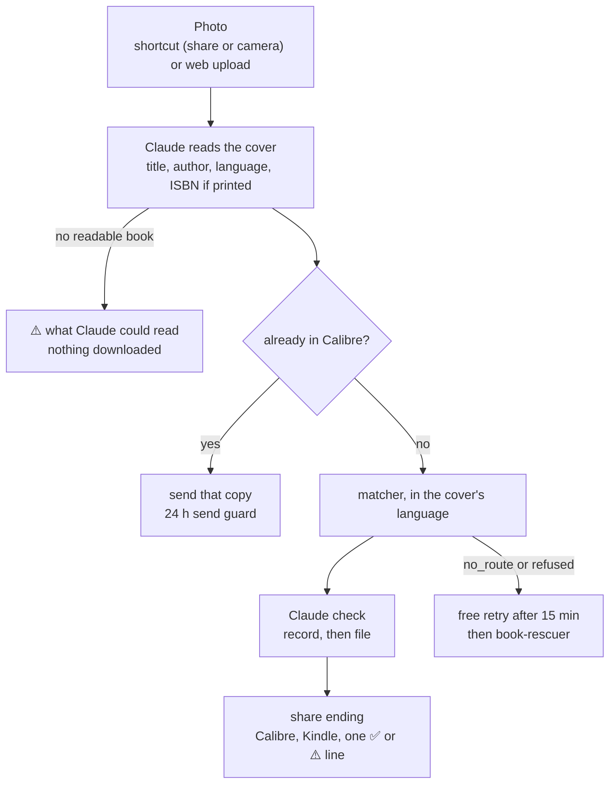

# Book from a photo

**Status:** designed, not built · **Date:** 2026-10-29 · **Owner:** Viktor ·
**Repos:** `book-search`, `claude-agent-service` (used as is) · **Namespace:** `ebooks`

## What this delivers

A photo of a book's front cover becomes a book in Calibre, and on a Kindle if
one was chosen. Claude reads the cover, and the book then goes through the same
matcher, Claude check and share ending that the Goodreads pipeline and link
shares use today. A photo can come from the phone shortcut (shared from Photos,
or taken with the camera) or from an upload on book-search's web page.

## Decisions

Viktor's choices, 2026-10-29:

| question | answer |
|---|---|
| where a photo comes from | the phone shortcut and a web upload |
| what a photo shows | one book's front cover |
| confirmation before download | none: a readable cover always downloads |
| a photo with no readable book | ends with ⚠️ and what Claude could read; nothing downloads |
| which pipeline | the Goodreads matcher and Claude check, then the share ending |
| recipient | the same choice as link shares |
| language | the edition in the language on the cover; none in that language is a miss |
| format | ebooks only |
| shortcut shape | one shortcut for links and photos, replacing today's for both people |
| shortcut run with nothing shared | opens the camera |
| phone reply | the wait loop shows ✅ or ⚠️ for photos and for links |
| book already in Calibre | its copy goes to the chosen Kindle, under the 24 h send guard |
| retries and rescue | the same as link shares, sharing the 2-a-day rescue cap |
| the photo itself | kept 7 days on `/stacks-config/book-search`, then deleted |
| web upload | photo picker, recipient choice, the job's progress and result on the page |

Decisions the design adds:

| decision | why |
|---|---|
| Claude reads the cover through claude-agent-service's `/v1/chat/completions` with an inline `data:` image | the endpoint already takes images (TripIt's ingest uses it), and the Claude check already calls it, so no new credential or service |
| model `sonnet`, as in the Claude check | the same model and cost path as the existing check |
| photos are sent as JPEG, at most 1568 px on the long edge | iPhone photos are HEIC, which claude-agent-service does not decode; the shortcut converts and resizes, and the server does the same for web uploads (Pillow with `pillow-heif`) |
| the shortcut change also finishes step 5 of [Book shares that always say how they ended](2026-09-24-book-shares-say-how-they-ended.md) | one reinstall for both people; the API key rotation and removing the Slack start line go with it, as that doc planned |
| signing on the Mac at `192.168.8.194` | `viktorbarzin-mbp-m4` answers there with `/usr/bin/shortcuts` (checked 2026-10-29); the `mac` ssh alias still points at the old `192.168.8.201` |

## How a photo share ends

The ✅ or ⚠️ line names the book Claude read, so a misread cover is visible on
the phone, on the web page and in Slack, for example
`✅ Под игото by Иван Вазов (bulgarian) → Anca's Kindle (epub, 41 s)`.

## Plan

1. **Cover reading.** A new `backend/photo.py` normalises the image (HEIC to
   JPEG, resize) and asks Claude for a JSON answer: `readable`, `title`,
   `author`, `language`, `isbn`. Anything unreadable from claude-agent-service
   is an outage, as in `verify.py`, so the share ends `claude_down` rather than
   as a miss. Tests use recorded answers.
2. **Matcher in any language.** `_is_usable`, `_rank` and `select_candidate`
   in `backend/goodreads/matcher.py` take a target language that defaults to
   English, so the Goodreads pipeline and link shares behave as today. Language
   names fold across forms (`Bulgarian`, `bg`, `bul`). The miss reason
   `no_english_edition` becomes `no_edition_in_language`, with the language in
   the line. Parameterised tests cover English, Bulgarian and an unknown
   language column.
3. **Photo share on the API.** `/api/download-url` also accepts an image body
   (`Content-Type: image/*`) or a multipart `photo` field, with the recipient in
   `X-Deliver-To` as today. The job stores the photo under
   `/stacks-config/book-search/photos/<job_id>.jpg`, which a daily sweep clears
   after 7 days. It then reads the cover, checks Calibre, finds a file with
   `_libgen_find_file` in the cover's language, runs the Claude check on the
   record and on the file, and ends through `_settle_job`. The rescue prompt
   gains the language.
4. **Web upload.** A photo picker and recipient choice on the main page post
   to the same endpoint and follow `/api/download-status/<job_id>` until the
   line arrives.
5. **Shortcut.** `tools/build_shortcut.py` accepts a Safari page or an image.
   An image is converted, resized and posted as the body. With nothing shared,
   the shortcut takes a photo. Both paths then ask the wait endpoint up to six
   times and show the last answer. This starts with a spike on the iPhone rig
   (see open questions), then both variants are signed on the Mac and
   reinstalled, the API key is rotated, and the Slack start line is removed.
6. **Live checks**, with the `smoke` recipient: an English cover, a Bulgarian
   cover, a photo with no book, a book already in Calibre, a web upload
   (screenshot of the page), and the shortcut on the iPhone rig for a photo, a
   camera capture and a link share.

## Open questions

- **Safari with a second input type.** On 2026-09-06, accepting a URL input
  next to the Safari page made Safari hand over the URL, and the link path
  failed (`build_shortcut.py`, `INPUT_CLASSES`). Accepting images may or may
  not do the same. The step 5 spike settles it before anything is signed. If
  Safari changes what it hands over, the fallback is a separate photo shortcut,
  and Viktor decides then.
- **Non-English coverage on libgen.** How often libgen has an EPUB of a
  Bulgarian book, and whether its search handles Cyrillic queries well, has
  not been measured. The first live checks will show it.
- **Language from a cover.** A translated book with an English cover reads as
  English. That follows the decision (the language on the cover), and is noted
  here so a surprising pick has an explanation.
- **The test iPhone is off its cable** (`homelab ios doctor`, 2026-10-29:
  device not connected). The shortcut checks in step 6 wait until it is back.
