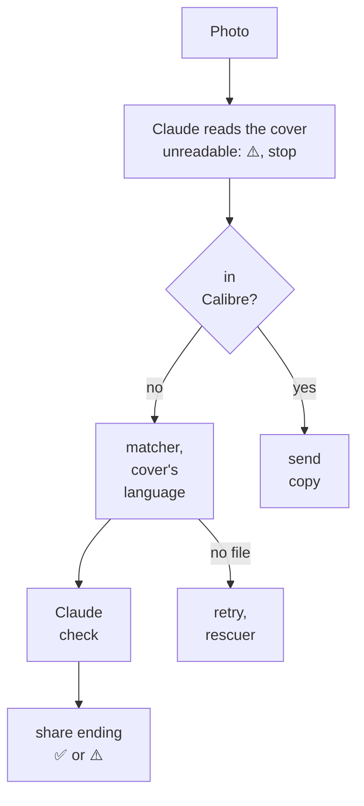

# Book from a photo

**Status:** live: server, web upload and the signed shortcut; both phones still to reinstall · **Date:** 2026-10-29, revised 2026-10-30 · **Owner:** Viktor ·
**Repos:** `book-search`, `claude-agent-service` (used as is) · **Namespace:** `ebooks`

## What this delivers

A photo of a book's front cover becomes a book in Calibre, and on a Kindle if
one was chosen. Claude reads the cover, and the book then goes through the same
matcher, Claude check and share ending that the Goodreads pipeline and link
shares use. A photo can come from the phone shortcut (shared from Photos, taken
with the camera, or picked from the library) or from an upload on
book-search's web page.

## Decisions

Viktor's choices, 2026-10-29, with one revision on 2026-10-30:

| question | answer |
|---|---|
| where a photo comes from | the phone shortcut and a web upload |
| what a photo shows | one book's front cover |
| confirmation before download | none: a readable cover always downloads |
| a photo with no readable book | ends with ⚠️ and what Claude saw; nothing downloads |
| which pipeline | the Goodreads matcher and Claude check, then the share ending |
| recipient | the same choice as link shares |
| language | the edition in the language on the cover; none in that language is a miss |
| format | ebooks only |
| shortcut shape | one shortcut for links and photos, replacing today's for both people |
| shortcut run with nothing shared | asks: Take a photo, or Choose from library (revised 2026-10-30, from camera only) |
| phone reply | the shortcut waits and shows the ✅ or ⚠️ line, for photos and for links |
| book already in Calibre | its copy goes to the chosen Kindle, under the 24 h send guard |
| retries and rescue | the same as link shares, sharing the 2-a-day rescue cap |
| the photo itself | kept 7 days on `/stacks-config/book-search`, then deleted |
| web upload | photo picker (camera or library on a phone), recipient choice, the job's result on the page |
| API key | not rotated with this release (2026-10-30) |

Decisions the design and the build added:

| decision | why |
|---|---|
| Claude reads the cover through claude-agent-service's `/v1/chat/completions` with `no_tools` and an inline `data:` image | the endpoint already takes images, and with no tools the text printed on a photo cannot make the agent do anything |
| model `sonnet`, as in the Claude check | the same model and cost path as the existing check |
| the cover reading asks for today's spelling and normal capitalisation | the first Bulgarian photo was an 1894 title page; Claude wrote "Подъ игото" as printed and the search found only an old-spelling scan |
| the matcher folds pre-reform Cyrillic, and libgen is searched in modern spelling too | the same case: libgen lists most copies in modern spelling |
| the server turns any photo into a JPEG of at most 1568 px; the shortcut sends 1600 px JPEGs | iPhone photos are HEIC, which claude-agent-service does not decode |
| the English miss reason stays `no_english_edition`; other languages end `no_language_edition` | the Goodreads pipeline already maps the English one |
| the web upload goes to `/photo-share`, behind Authentik, with named recipients only | only the four API paths skip Authentik, so this path needs no API key and must not accept an address |
| the shortcut tells a page from a photo by the input's type, and shows the answer with Quick Look | coercing a Photos item to a Safari page threw on the iPhone, and a text test on "Contents of URL" imported broken, so the answer is not tested at all; a finished share answers each remaining wait at once |
| the shortcut change also finishes step 5 of [Book shares that always say how they ended](2026-09-24-book-shares-say-how-they-ended.md) | one reinstall for both people; removing the Slack start line goes with that install |
| signing on the Mac, reached directly on the London LAN | `tools/sign_shortcut.sh` takes `MAC_HOST`; the Mac's address rotates, and `homelab ios doctor` names it |

## How a photo share ends

The ✅ or ⚠️ line names the book Claude read, so a misread cover is visible on
the phone, on the web page and in Slack, for example
`✅ Под игото by Иван Вазов (Bulgarian) was already in Calibre`.

## What is built

- `backend/photo.py` turns a photo into a JPEG and asks Claude for `readable`,
  `title`, `author`, `language` and `isbn`. An outage or an unreadable reply
  ends the share `claude_down`, never as a miss.
- The matcher and the Claude check take a target language (English unless a
  photo share asks for another). Titles keep letters of any script.
- `/api/download-url` takes an image body or a multipart `photo` field;
  `/photo-share` takes the web page's upload. Both run the cover reading, the
  Calibre check, `_libgen_find_file` with the Claude check on each pick, and
  `_settle_job`. A photo share with no file gets the free retry and the rescue
  agent like a link share; the retry looks again from the reading.
- The web page has a photo picker, a recipient choice and the share's result.
- The shortcut generator builds the combined shortcut, and `/shortcut` serves
  both signed variants (signed on the Mac on 2026-10-30).

## Checked on the live system

| check | what happened |
|---|---|
| English cover, test Kindle, public URL | `✅ FLATLAND by Edwin A. Abbott → Smoke's Kindle (epub, 75 s)`; the file check refused a French copy that libgen listed as English, and the next copy went through |
| 1894 Bulgarian title page | read as "Подъ игото"; the search found only an old-spelling scan and Claude was unsure of it; the retry failed the same way; the rescue agent found a modern EPUB and it reached the test Kindle. Fixed since: modern spelling in the reading and in the search |
| the same page after the fix | `✅ Под игото by Иван Вазов (Bulgarian) was already in Calibre` |
| a picture with no book | `⚠️ … no book cover could be read in that photo …` with what Claude saw |
| a book already in Calibre | `✅ Flatland by Edwin A. Abbott was already in Calibre`, nothing downloaded |
| web upload, phone-width page | `✅ The Time Machine by H. G. Wells → Calibre (epub, 48 s)` (driven through a port-forward to the live service, since the browser had no Authentik session) |
| shortcut import on the iPhone | the signed file imports and asks for the API key |
| shortcut, nothing shared | the menu offers Take a photo and Choose from library |
| shortcut, choose from library | `✅ The War of the Worlds by H. G. Wells → Calibre (epub, 47 s)` |
| shortcut, camera | the ⚠️ line for a blurry photo, shown in Quick Look after the waits |
| shortcut, Safari page | Safari still hands over the page with images accepted; `✅ … → Calibre (epub, 19 s)` in Quick Look |
| shortcut, photo shared from Photos (first build) | failed: coercing the photo to a Safari page threw. Fixed in the generator by reading the input's type |
| shortcut, photo shared from Photos (signed build) | `✅ The War of the Worlds by H. G. Wells was already in Calibre` in Quick Look |
| shortcut, Safari page (signed build) | `✅ Bram Stoker's Dracula → Calibre (epub, 14 s)` in Quick Look |

## Not done yet

- Both phones reinstall the shortcut from `/shortcut`, with the current key.
- Then remove the Slack start line for link shares, as the 2026-09-24 doc
  planned; it stays until both phones have the shortcut that shows the result.

## Open questions

- **Language from a cover.** A translated book with an English cover reads as
  English. That follows the decision (the language on the cover), and is noted
  here so a surprising pick has an explanation.
- **Non-English coverage on libgen.** Под игото had about a dozen Bulgarian
  EPUBs, FB2s and MOBIs. One book is not a measure of coverage in general.

The two questions open in the first version are settled: Safari still hands
over the page when the shortcut accepts images, and the test iPhone is back on
its charger with taps working again (its WebDriverAgent was re-signed on
2026-10-29 after a fresh Apple ID login).
